# Form & Field

**An open-source ecommerce platform in plain PHP + MySQL.** No framework, no build step, no Composer: copy it to any PHP host and sell. A responsive storefront, a full merchant workspace, and Medusa-style commerce features (multi-currency pricing, promotions with usage limits, reviews), built to be easy to read and easy to contribute to.

[](https://github.com/nabilrt/form-field/actions/workflows/tests.yml)
[](LICENSE)
[](CONTRIBUTING.md)


## Highlights

- **Storefront:** catalog with filters and live search, product pages with variant chips, build-a-set bundles, compare, saved items, recently viewed, reviews.
- **Checkout:** cash on delivery and bank transfer, promo codes, saved addresses, guest or account checkout, printable invoices.
- **Returns:** shoppers request returns on delivered orders; merchants receive (auto-restock), refund with a discount-aware suggestion, or reject.
- **Multi-currency:** shoppers pick their currency; merchants set per-variant prices per currency or fall back to exchange rates.
- **Merchant workspace:** products and variants, orders, returns, customers, collections, discounts with usage limits, currencies, review moderation, analytics, CSV export.
- **Secure by default:** prepared statements, CSRF on every form, strict CSP, per-account login throttling, re-encoded uploads.
- **Progressive enhancement:** every page works without JavaScript; with it, the bag, search and add-to-bag update in place.

## Screenshots

| Shop | Product |
| --- | --- |
| 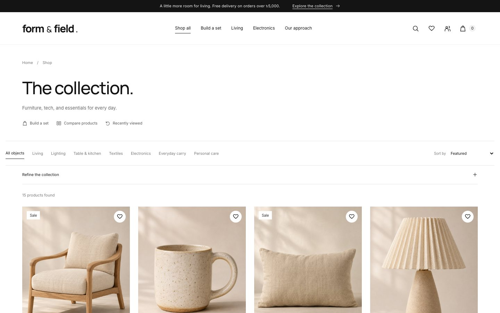 | 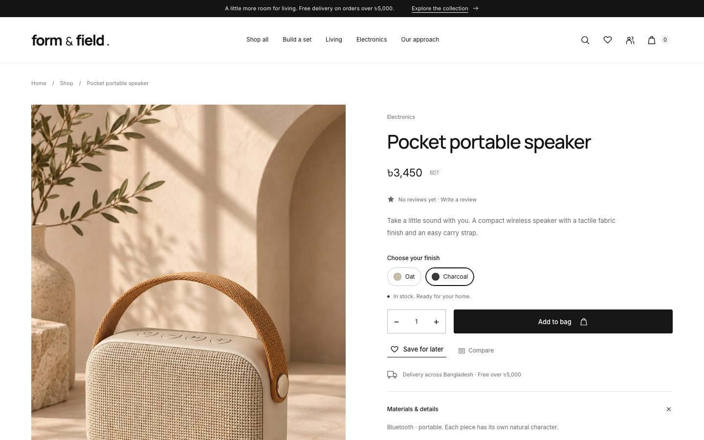 |
| **Live search** | **Add to bag without leaving the page** |
| 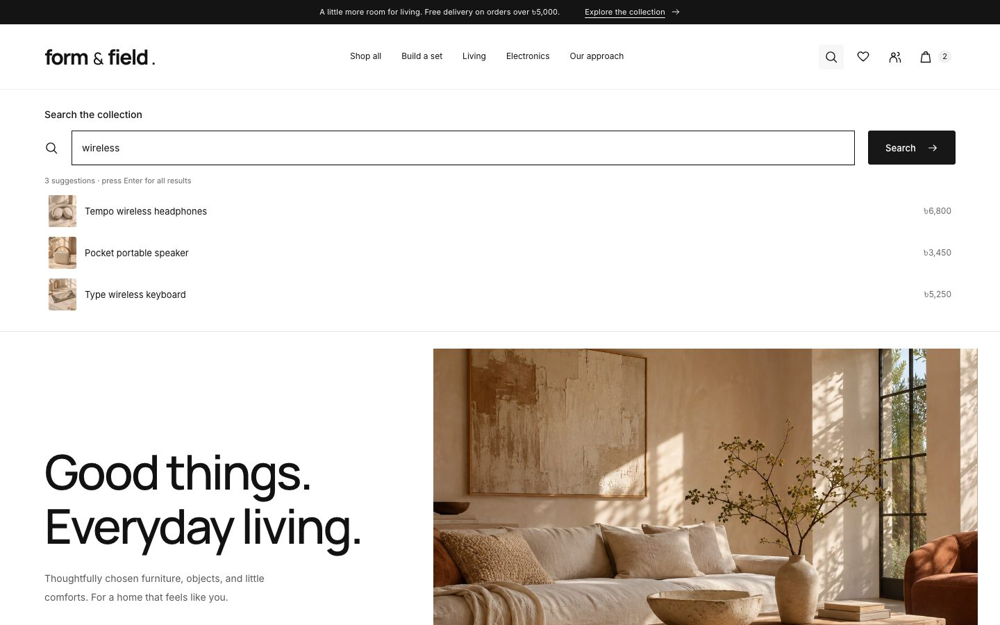 | 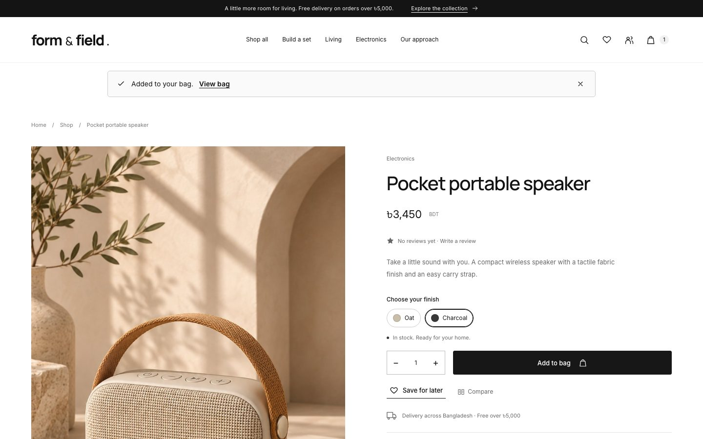 |
| **Bag** | **Checkout** |
| 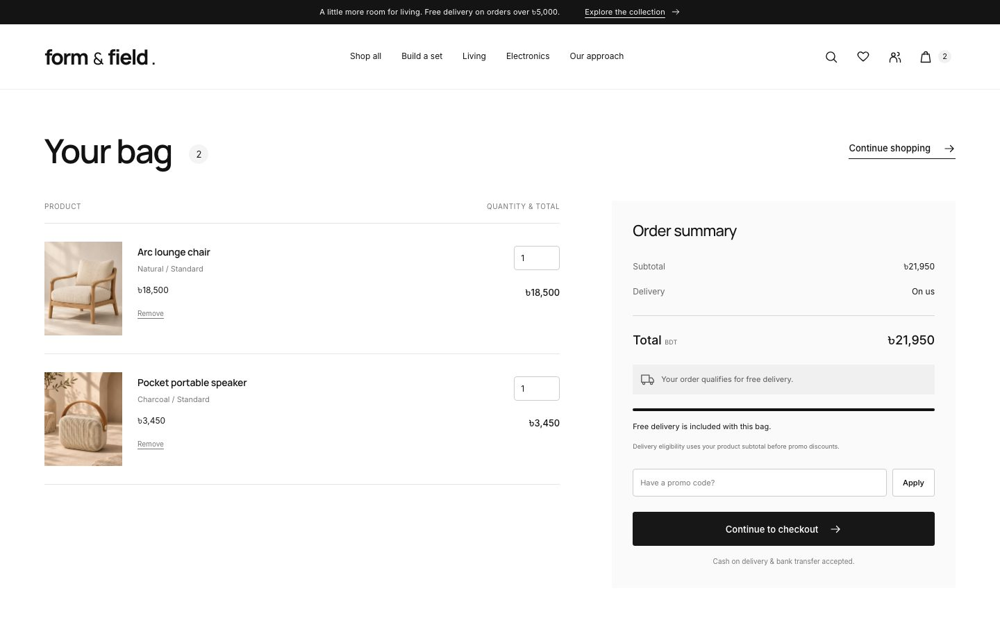 | 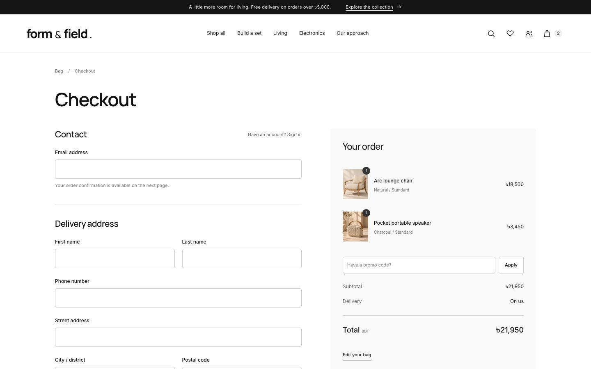 |
| **Build a set** | **Mobile** |
| 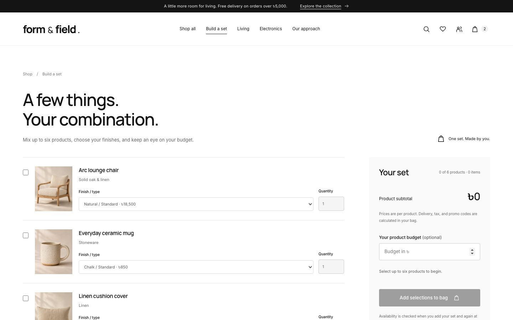 | 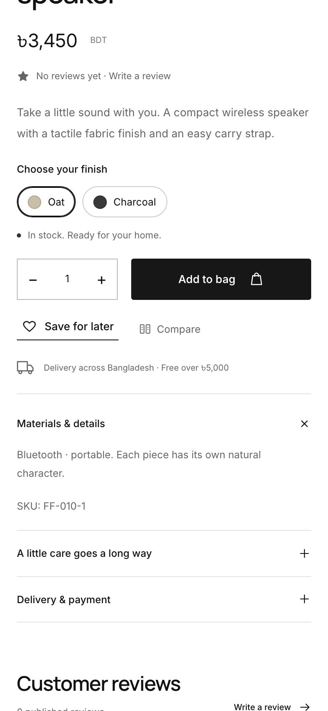 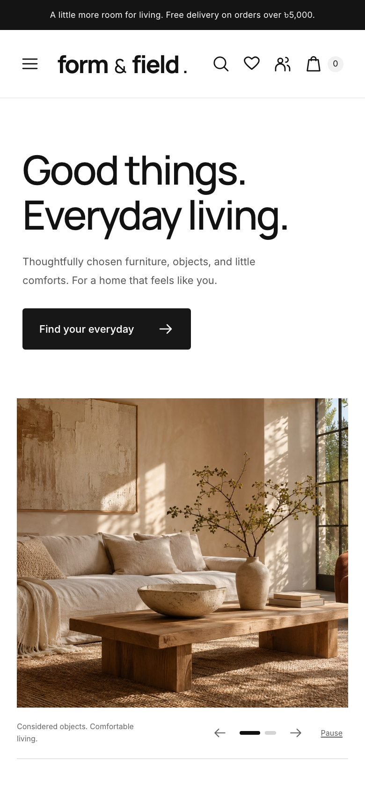 |

**Merchant workspace**

| Products | Product editor |
| --- | --- |
| 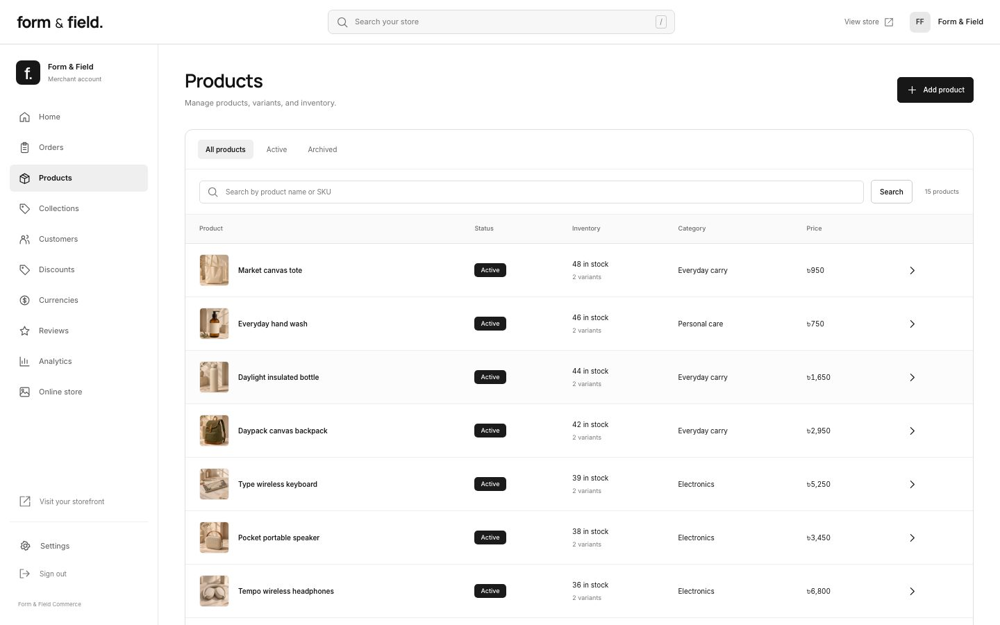 | 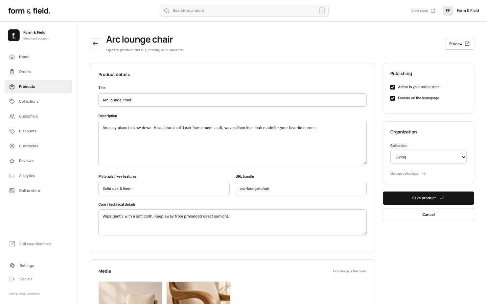 |
| **Discounts with usage limits** | **Currencies** |
| 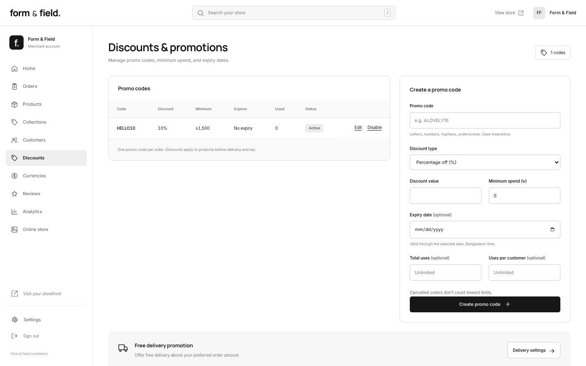 | 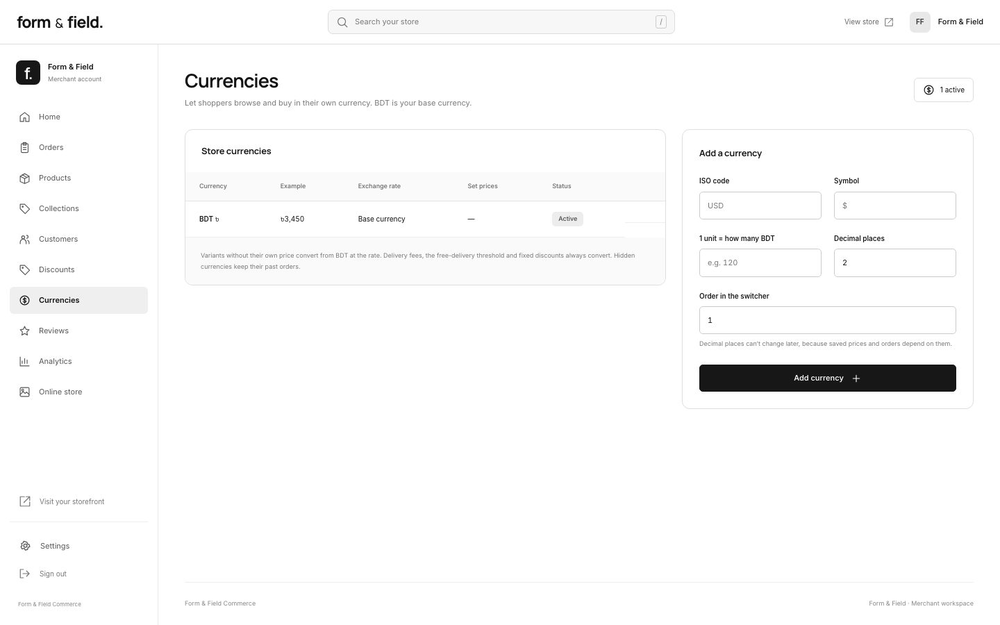 |
| **Analytics** | |
| 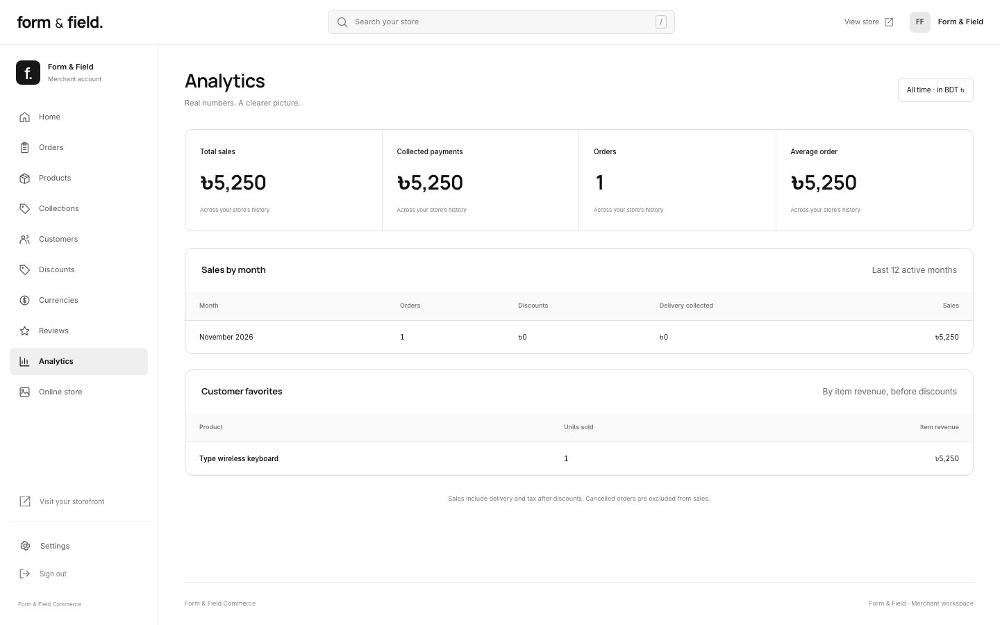 | |

Interface: white backgrounds, black controls, Inter for interface text and Manrope for headings.

## Run locally

Requires PHP 8.2+ with `pdo_mysql`, `fileinfo`, `gd` (WebP support), `mbstring`, and a running MySQL 8+ server. No Composer, Node, npm build, or frontend framework is required.

```sh
cp .env.example .env
```

Edit `.env` with your MySQL host, port, database, username, and password. If you use a Unix socket, set `DB_SOCKET` to its path. The installer creates the database if your MySQL account has permission; otherwise create the database first and grant that account access.

```sh
php scripts/install.php
php -S 127.0.0.1:8080 -t public router.php
```

Open **http://127.0.0.1:8080** for the storefront and **http://127.0.0.1:8080/admin** for the merchant workspace. The installer prints a randomly generated admin password once. Save it. The default admin email is `admin@formandfield.test`.

To choose credentials when first installing, set `ADMIN_EMAIL` and `ADMIN_PASSWORD` in your shell environment before running the installer. Use a password of at least 12 characters. The installer preserves existing products, orders, settings, and admin accounts when run again.

## Included

- **Catalog:** 15 illustrative products in seven collections: Living, Lighting, Table & kitchen, Textiles, Electronics, Everyday carry, and Personal care. Variant-specific SKUs, options, prices, compare-at prices, and stock.
- **Storefront:** editable homepage slideshow, collection browsing, search, sorting, pagination, sale filtering, product galleries, keyboard-accessible image lightbox, and responsive layouts.
- **Bag and checkout:** server-side session cart, quantity editing/removal, promo codes, configurable delivery and tax, guest checkout, saved-address checkout, separate billing address, customer notes, cash on delivery, and bank transfer.
- **Orders:** price and item snapshots, private confirmation links, printable invoices with browser Save as PDF, customer order history, merchant fulfillment and payment statuses, and inventory restoration when cancelled.
- **Customer accounts:** registration, sign-in/out, profile and password changes, saved addresses with editing, removal and a default address, and access to their own order history.
- **Merchant workspace:** actual sales analytics, product and variant editing, multi-image uploads, archive/unarchive, collections, customer lists, order management, promo activation/expiry, slideshow editing, delivery/tax settings, bank instructions, and password updates.
- **Discounts:** percentage and fixed-amount codes, minimum spend, expiry date, activation controls, product sale prices, and a configurable free-delivery threshold. Try the seeded `HELLO10` code on product subtotals of ৳1,500 or more.
- **Assets:** 18 locally stored generated photographs and locally hosted variable fonts. No remote image or font request is required. See [ASSETS.md](ASSETS.md).

## Merchant setup

Before accepting real orders, open **Admin → Settings** and enter your contact details, business address, delivery fees, applicable tax rate, and bank transfer instructions. Bank transfer is intentionally unavailable until real bank details are saved. Cash on delivery works immediately. All amounts are in **BDT (৳)**, rounded to whole taka.

The stock, photographs, prices, descriptions, and product specifications are sample catalog content. Replace them with the actual goods you sell. No real orders or fabricated sales data are seeded.

Admin → Products → Add product supports multiple JPG, PNG, or WebP images (up to 12 files per submission, 5 MB each). Images are checked and re-encoded as WebP with random filenames. The first retained gallery image is the cover; new images append to the gallery. Raise PHP's `post_max_size`, `upload_max_filesize`, and `max_file_uploads` as needed (for example `64M`, `5M`, and `12`). Ensure the PHP process can write to `public/uploads` and its session directory.

## Payment and order behavior

Bank transfer records an **unpaid** order and shows the bank instructions and order reference; it does not process a card or verify the transfer automatically. Verify the payment, then mark the order paid in the admin. Cash on delivery is also unpaid until you collect it. Marking an order refunded records your bookkeeping status; issue the actual refund through the original payment channel.

Checkout reloads product prices, validates the active promo code, locks inventory rows, creates the order/items, and decrements stock in one transaction. A submission nonce is consumed on success to prevent duplicate orders. Cancelled orders restore stock once and cannot be reopened. Invoices retain the item name, SKU, variant, unit price, quantity, and order totals from checkout.

Free delivery is based on the product subtotal **before** promo discounts. Promo discounts apply only to products; tax applies to the discounted product subtotal. Codes are case insensitive, one per order, and valid through their expiry date in Bangladesh time.

Order and invoice links contain a long random bearer token so guest customers can open them. Treat those links as private. Logged-in account history only includes orders placed while signed in; guest orders are not attached to an account by email alone.

Newsletter subscriptions are saved in the database. Confirmation screens and invoices are available in the browser. This application does **not** send transactional email, offer email password recovery, or integrate a courier/payment gateway. Those require the merchant's provider setup; no fake delivery or payment integrations are included.

## Deploy to PHP hosting

Point your web server's document root at **`public/`**, keeping `.env`, `app/`, `database/`, and `storage/` outside the public root. Use HTTPS. Apache rewrite rules are included in `public/.htaccess`. For nginx, route missing paths to `/index.php`, disable directory listing, and serve `uploads/` as static files only (never execute PHP in that directory). Keep database and uploaded-file backups.

Example nginx routing:

```nginx
location / { try_files $uri $uri/ /index.php?$query_string; }
location ^~ /uploads/ {
    location ~* \.(php|phtml|phar|cgi|pl|html|svg)$ { deny all; }
    try_files $uri =404;
}
location ~ \.php$ {
    try_files $uri =404;
    include fastcgi_params;
    fastcgi_param SCRIPT_FILENAME $document_root$fastcgi_script_name;
    fastcgi_pass unix:/run/php/php-fpm.sock; # use your host's PHP-FPM socket
}
```

## Verification

```sh
python3 tests/integration.py
php tests/mysql-smoke.php
node --check public/assets/app.js
```

The Python integration suite needs PHP's `pdo_sqlite` extension. It copies application source into a temporary directory, creates an isolated SQLite fixture with a small MySQL syntax adapter, and runs real PHP routes/actions through CLI. It never changes your configured MySQL database. This checks application behavior, including accounts, stock, checkout price tampering, discount validation, invoices, cancellation, and admin pages. It does **not** validate MySQL execution or concurrent InnoDB locking; run the native MySQL smoke check and browser checkout against your installation as well.

During development in the provided environment, local network listeners were blocked, the installed MySQL binary crashed during initialization, and Chromium was blocked by macOS sandbox permissions. PHP/JS syntax and isolated application checks could run; a live MySQL/browser preview could not be verified there.

## Query safety and performance

Database values use native PDO prepared statements with emulation disabled. The query helper binds integer, boolean, null, and string types explicitly. Sort expressions come from a fixed allowlist, page limits/offsets are bound integers, and dynamic `IN` lists contain only generated placeholders. Controller-authored SQL fragments contain no request text. Invoice lookups use random tokens, and address/order-account queries include the authenticated owner ID.

Catalogs are paginated in SQL, and product cards share one batch variant lookup instead of making queries for each card. Cart items also load in one query. Indexes cover collection/featured filters, minimum variant prices, gallery ordering, customer order history, order status/date/email, saved addresses, and visible slides. Checkout locks inventory in variant-ID order and keeps all order/stock writes in one InnoDB transaction. Price sorting includes a unique product-ID tiebreaker for stable pagination.

The 177-check integration suite includes hostile search, sort, page, login, and invoice inputs, plus a query-count assertion for catalog pages. Native MySQL execution plans and concurrency still need verification on your configured server; no production performance benchmark is claimed.

## Formatting

Source files are readable, unminified source. PHP follows PSR-12 with the project `pint.json` configuration; `.prettierrc.json` records the CSS/JavaScript/template settings, and `.editorconfig` supplies consistent four-space indentation. Formatting tools are development-only and are not needed to run the store.

## Settings and interface behavior

Admin settings are grouped into General, Delivery & tax, Payments, Storefront, and Security tabs. Tabs support arrow keys, Home/End, and direct links such as `/admin/settings#payments`. Each form saves only its own group; validation failures keep the tab selected, and invalid updates do not partially change stored values. Without JavaScript, every settings form remains available on the page.

Password fields in customer and merchant forms have Show/Hide controls. Revealed passwords are concealed again when the page loses focus, is left, or the form submits. Password managers and autocomplete continue to use the original fields.

The admin footer follows the content and reaches the viewport bottom on short pages. Shared controls provide short hover/press feedback; settings changes, notifications, search, galleries, and supported browser navigations use restrained transitions. Reduced-motion preferences disable these movements, and ordinary page navigation remains the fallback where browser view transitions are unsupported.

## Additional shopping and merchant features

- **Saved items:** the heart controls on product cards and product pages keep up to 50 product IDs in this browser’s local storage. Open the header heart to revisit them. The list persists across visits in that browser, updates across browser tabs, and removes products that have been archived. It is not synchronized to customer accounts or other devices. JavaScript and browser storage are required for saving; no personal details are stored in the wishlist.
- **Catalog filters:** combine collection, search, minimum/maximum whole-taka price, stock availability, sale status, and sorting. Filters stay selected when switching category, sorting, or changing pages. Price, availability, and sale filters must match the same variant; the displayed starting price and price sorting use the matching variants.
- **Buy again:** signed-in customers can add a previous order’s available variants to their existing bag from order history. Quantities are capped by current stock and a maximum of 99 per variant. Current prices apply, historical discounts are not copied, unavailable items are reported, and the original order/invoice is preserved. Checkout validates stock and prices again before placing a new order.
- **Order export:** Admin → Orders → Export CSV downloads all orders matching the current status and search filters. The export uses batches of 500 with ID cursors and a fixed maximum ID for the export, includes BDT totals and payment/fulfillment states, and treats formula-like customer text as spreadsheet text. Merchant authentication is required; invoice tokens are not exported.
- **Expanded homepage:** new arrivals, an electronics selection, and delivery/payment/account/invoice FAQs supplement the existing slideshow, collections, featured products, and editorial section. Products and delivery values are read from the live catalog/settings.

The wishlist, catalog filters, reorder action, CSV export, and homepage additions require no database migration or new runtime dependencies. Product reviews require the one-time migration below. The expanded integration suite covers filter combinations and matching prices, saved-list route safety, reorder ownership/stock/history, CSV formula handling, and export pagination across the 500-row boundary. Browser-local storage and interactive rendering still require verification in a live browser.

## Product reviews

For an existing installation, enable review storage once:

```sh
php scripts/migrate-reviews.php
```

To enable promo code usage limits on an existing installation, run `php scripts/migrate-coupon-limits.php` once (idempotent; existing codes stay unlimited).

To enable multiple currencies on an existing installation, run `php scripts/migrate-currencies.php` once (idempotent; existing orders are recorded as BDT). Then add currencies under Admin → Currencies; shoppers pick theirs from the header.

To enable returns on an existing installation, run `php scripts/migrate-returns.php` once (idempotent). Shoppers can then request returns from their order page for 30 days after ordering; change the window under Settings → Delivery & tax (0 turns online returns off). Refunds are recorded in the admin; pay them out the way the customer paid.

New installations receive the table through `php scripts/install.php`. The review migration is idempotent and only creates `product_reviews`; it does not replace or reseed products, customers, or orders. Until it runs, the storefront continues working and Admin → Reviews displays setup instructions. The provided environment blocked the MySQL connection, so the migration could not be applied there.

Signed-in customers can submit a 1–5 rating, a title (3–140 characters), and a written review (10–4,000 characters). Each customer has one review per product, enforced in the database. They can edit or withdraw it from the product page. Reviews start as **pending**, and edits return published reviews to moderation. Submitted text is escaped and rendered as plain text. Drafts are scoped to the customer session and cleared at sign-out.

Admin → Reviews provides Pending, Published, Rejected, and All views, search, pagination, and publication/rejection controls. Only approved reviews appear publicly or count toward the average and star distribution. Moderation cannot rewrite a review’s words or rating. Revision checks prevent publishing a customer edit that the moderator has not read. Publish genuine feedback regardless of its rating; moderation is for spam, abuse, unrelated content, and private information.

Verified-purchase badges are computed on the server from a matching paid, delivered order in the reviewer’s account; they cannot be supplied by the reviewer. The order check uses retained order-item/variant links. Once established, verification is preserved through later review edits. Public author names show a first name and last initial; emails are never selected for public review listings.

Ratings are batch-loaded for catalog pages. Covering rating indexes and product/status/date indexes support aggregates and paginated lists, without adding a query per product card or per review. With reviews enabled, the isolated catalog check uses seven queries for either four or twelve cards. No reviews or ratings are seeded into a real installation.

The integration suite covers authentication, CSRF, rating/text validation, draft privacy, pending/approved visibility, verified-purchase spoofing, publication of negative reviews, revision conflicts, author-only withdrawal, stored-XSS escaping, SQL-shaped inputs, pagination, and behavior before migration. Native MySQL execution and live browser rendering remain unverified in the provided environment.

## Comparison, sets, and browsing history

- **Compare products:** use Compare on catalog cards or product pages to select up to three active products. The floating tray opens `/compare`, with prices, materials/features, available finishes, stock, approved ratings, and care/technical details. Show only differences hides identical rows. Selections live in the PHP session; native POST forms work without JavaScript, with JSON updates when available.
- **Build a set:** `/build-a-set` lists up to 30 available products. Choose up to six different products, variants, and quantities of 1–10. A live subtotal and optional whole-taka product budget help plan the selection; the budget is advisory and does not impose a discount or spending limit. Stock validation includes items already in the bag. Every selection must pass before any cart item is changed. Current server prices, delivery, tax, and promo rules apply in the bag and checkout. No inventory is reserved by adding a set.
- **Recently viewed:** product visits retain the latest eight unique product IDs in the PHP session. Revisited products move to the front. `/recent` provides the full list and a clear-history action; homepage/product strips show up to four. Archived products are excluded. History is session-specific and does not synchronize across devices.
- **Delivery planner:** the bag shows progress toward the configured free-delivery threshold and links to available products priced within the remaining amount. Eligibility uses the subtotal before promo discounts.

The interface adds navigation underlines, preloaded gallery crossfades, comparison-tray entry feedback, and brief subtotal feedback. A mobile set-builder bar keeps totals and the Add action reachable. Reduced-motion preferences disable movement. Core comparison, history, and set submission remain usable without JavaScript; live budget updates require JavaScript.

These additions require no schema migration or new runtime dependency. The isolated suite covers selection limits, malformed IDs, safe return routes, CSRF, all-or-nothing set submission, variant ownership, stock bounds, browsing order/privacy, and the delivery planner. All 177 application checks pass. Live browser interaction/layout and native MySQL execution remain unverified under the environment restrictions described above.

## Contributing

Contributions are welcome, from typo fixes to new commerce features. Read [CONTRIBUTING.md](CONTRIBUTING.md) for setup, the test suite and code conventions, and [SECURITY.md](SECURITY.md) to report vulnerabilities privately. Good first areas: translations, payment gateways (bKash, Nagad, SSLCommerz, Stripe), regions and tax rules, email notifications, and exchanges on top of returns.

## License

[MIT](LICENSE). Use it, modify it, and run your own store with it. Demo product photos are AI-generated sample images and the Inter and Manrope fonts are under the SIL Open Font License; see [ASSETS.md](ASSETS.md).
